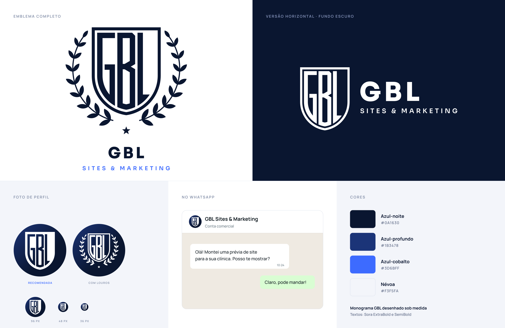

# Marca GBL — Sites & Marketing

Emblema: escudo com o monograma **GBL**, ramos de louro e estrela. As letras foram desenhadas sob medida para seguir as bordas do escudo com a mesma espessura: a curva do G e o pé do L acompanham a ponta do escudo. Passa solidez e confiança.



## Qual arquivo usar em cada lugar

| Onde | Arquivo |
|---|---|
| **Foto de perfil do WhatsApp Business** | `gbl-perfil-whatsapp.png` (só o escudo; é a que melhor se lê pequena) |
| Foto de perfil do WhatsApp, versão com louros | `gbl-perfil-whatsapp-louros.png` |
| **Foto de perfil do Instagram / Facebook** | `gbl-perfil-instagram.png` (ou `-louros`) |
| Propostas, apresentações, capas, cartão de visita | `gbl-logo-vertical.png` (emblema + GBL + slogan) |
| Topo de site, assinatura de e-mail, cabeçalho de PDF | `gbl-logo-horizontal.png` (escudo + GBL + slogan) |
| Só o símbolo grande (marca d'água, carimbo, adesivo) | `gbl-emblema.png` |
| Só o escudo (espaços pequenos) | `gbl-escudo.png` |
| Fundos escuros ou fotos | qualquer versão `-branco` |
| Ícone da aba do navegador do seu site | `favicon.svg` / `favicon-512.png` |

- **PNG** serve para o dia a dia (WhatsApp, Canva, Word, redes sociais). As versões de logo têm fundo transparente.
- **SVG** é vetor: pode ampliar o quanto quiser sem perder qualidade. Use em sites e gráficas.

## Cores

| Nome | Hex | Uso |
|---|---|---|
| Azul-noite | `#0A1630` | Emblema, textos e fundos escuros (cor principal) |
| Azul-profundo | `#1B3478` | Gradiente das fotos de perfil |
| Azul-cobalto | `#3D6BFF` | Slogan e destaques (botões, links) |
| Névoa | `#F3F5FA` | Fundos claros |

## Tipografia

- **Monograma GBL do escudo:** desenhado sob medida. Não existe fonte com essas letras: use sempre os arquivos.
- **"GBL" e slogan:** Sora ExtraBold e Sora SemiBold (grátis no Google Fonts).

## Cuidados

- Não estique, não incline e não mude as cores.
- Deixe um respiro em volta do logo de pelo menos a altura da estrela.
- Em fundo escuro ou foto, use as versões `-branco`.
- **Os louros perdem detalhe em tamanho pequeno.** Abaixo de 150 px de altura, use o escudo sozinho (`gbl-escudo` ou `gbl-logo-horizontal`).

## Outras versões

- `anterior-linha-de-conexao/`: a primeira logo criada ("Linha de Conexão"), com o pacote completo.
- `opcoes-geometricas/`: as opções em moldura (hexágono, escudo, escudo com louros) e o código que as gera.

## Editar ou gerar de novo

Os arquivos-fonte estão em `fonte/`. Para gerar tudo de novo, por exemplo depois de mudar uma cor no `pack.js`:

```bash
cd fonte
```

```bash
npm install
```

```bash
npm run gerar
```
